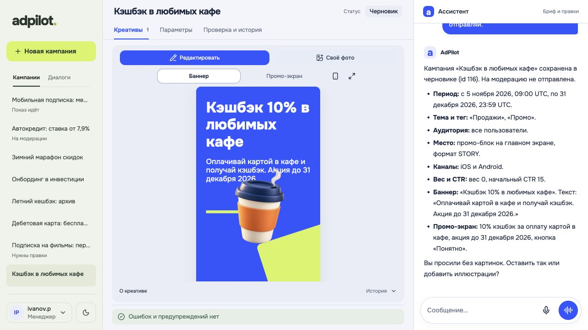
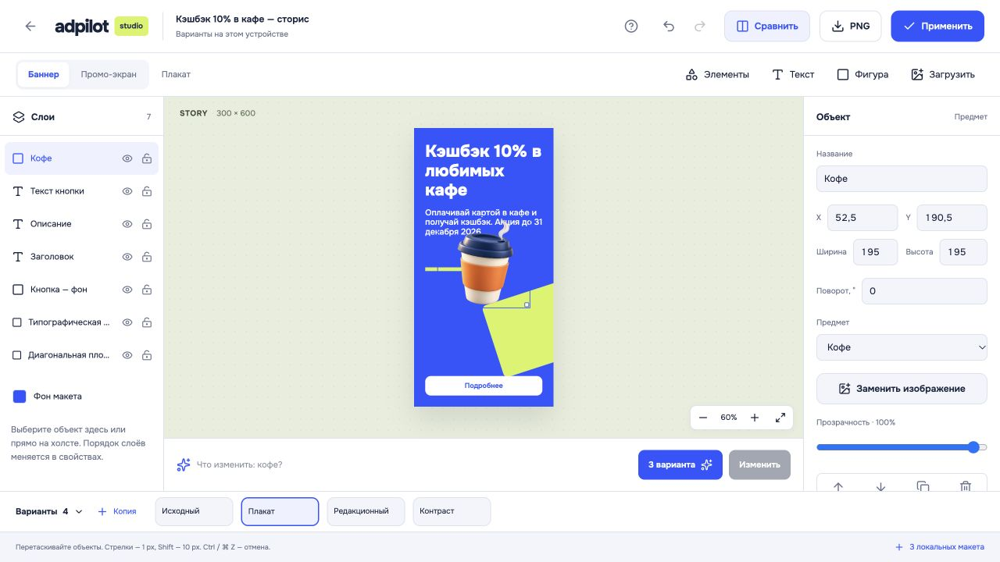
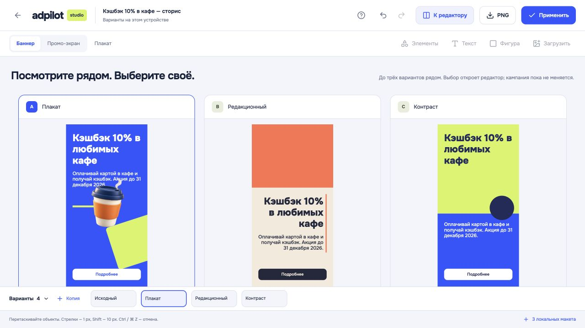
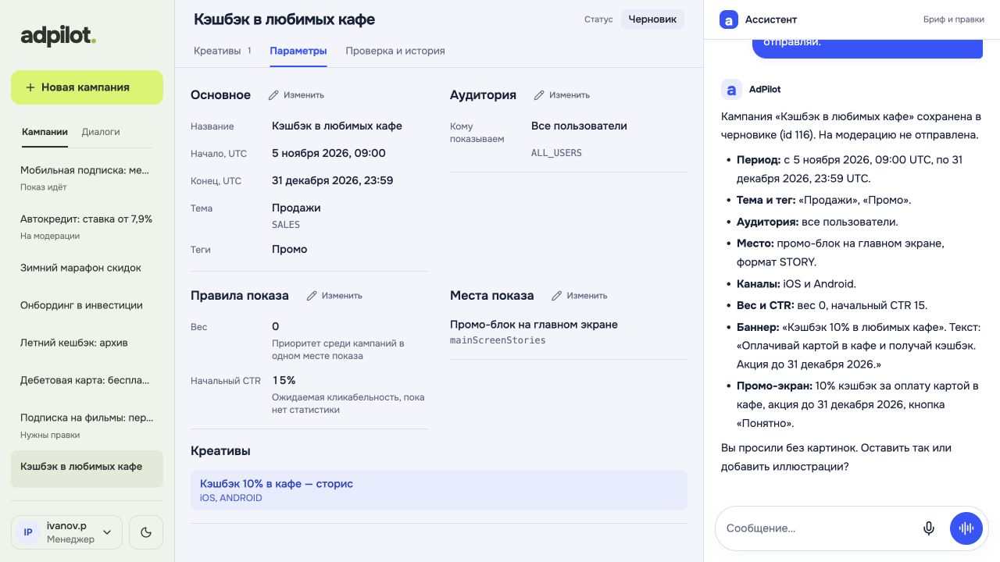
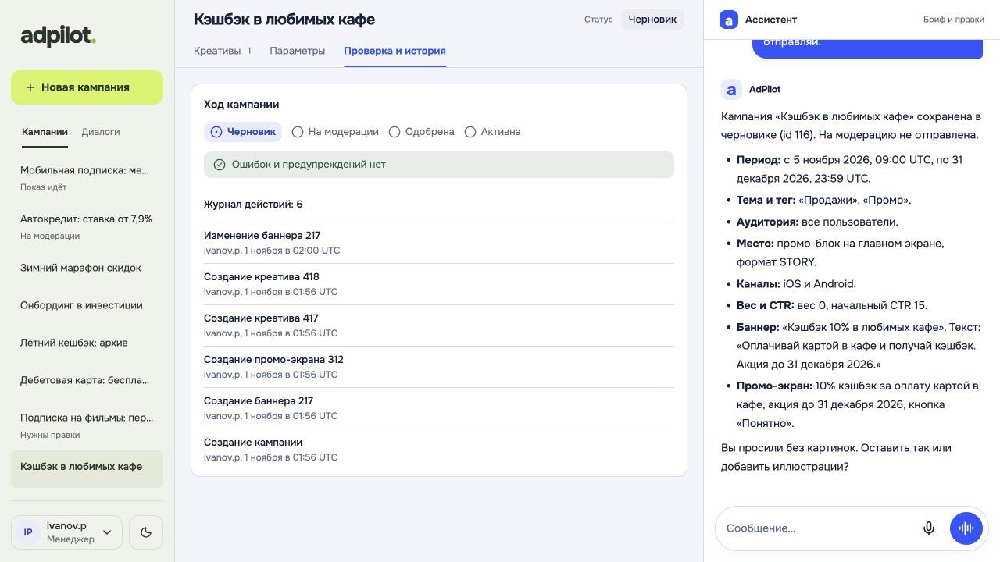

# AdPilot AI

Из брифа в рекламную кампанию, которую можно проверить и отправить на модерацию.

Команда chupapis, SibКод от Школы 21, Новосибирск. Кейс № 1: AI-powered система для заведения рекламных кампаний в приложении банка.

Менеджер описывает продукт, аудиторию и сроки обычными словами. AdPilot подбирает значения из справочников, уточняет недостающее и собирает кампанию: параметры, сегменты, места показа, баннеры и промо-экраны. Результат сразу виден рядом с диалогом. Перед сохранением ассистент показывает, что именно изменится, и ждёт нажатия «Подтвердить».

Креатив можно доработать самому: переставить текст, заменить фон, добавить фотографию или предметную иллюстрацию. В студии есть слои, отмена правок, AI-редактирование выделенного объекта и сравнение вариантов. На модерацию отправляется проверенная кампания; одобряет или возвращает её человек с ролью модератора.

- Справочники и ID ассистент получает через инструменты. Для сегментов объясняет включение по **ИЛИ**, исключения и ограничения готовых аудиторий.
- JSON баннеров и PROMO проверяется по схемам до записи. Ошибки и предупреждения можно разобрать в том же диалоге, включая замечания модератора.
- Сервер проверяет роли и переходы состояний, сохраняет аудит изменений. Диалог и ожидающее подтверждение переживают перезапуск.
- Кроме текстового чата есть диктовка и голосовой режим. Они используют тот же процесс подтверждения записей.

Попробовать без установки: [adpilot-ai-navy.vercel.app](https://adpilot-ai-navy.vercel.app). [REST API и Swagger](https://adpilot-ai-api.fly.dev/docs).



| Студия: слои и предметные иллюстрации | Сравнение вариантов рядом |
|---|---|
|  |  |
| Параметры и текущий статус | Проверка и история изменений |
|  |  |

Снимки сделаны на локальном стенде с настоящим API. В примере креатив после генерации вручную доработан в студии.

## Запуск

Нужны Git и Docker с Compose **2.24 или новее**. Python и Node.js на компьютере для этого запуска не требуются.

```sh
git clone https://github.com/lapcevichme/chupapis-ad-slop.git
cd chupapis-ad-slop
cp .env.example .env
docker compose up --build
```

Миграции и синтетические данные загружаются автоматически: сервис `migrate` завершится с кодом 0, затем запустятся API и интерфейс. База, история диалогов и загруженные материалы сохраняются в Docker volume.

| Адрес | Что открыть |
|---|---|
| [localhost:5173](http://localhost:5173/) | интерфейс менеджера и модератора |
| [localhost:8000/docs](http://localhost:8000/docs) | Swagger с контрактом API |
| [localhost:8000/health](http://localhost:8000/health) | проверка API: `{"status":"ok"}` |

Без ключей работают справочники, кампании, ручное редактирование, проверки, модерация и студия с локальными макетами. Для диалога с ассистентом нужен ключ LLM.

### С ключом модели

В корневом `.env` заполните `LLM_API_KEY` ключом [OpenRouter](https://openrouter.ai/settings/keys) с доступом к моделям из `.env.example`. Затем пересоздайте backend:

```sh
docker compose up -d --force-recreate backend
```

По умолчанию чат использует `anthropic/claude-haiku-5.5`, дизайнер — `anthropic/claude-sonnet-5.5`, генератор иллюстраций — `openai/gpt-image-2.5-sunburst`. Имена моделей и адрес провайдера настраиваются через окружение; LLM отделена от логики агента. Если изображения недоступны, основной сценарий можно пройти без них. Пустое `IMAGE_MODEL=` отключает генератор изображений.

Для основного голосового режима дополнительно нужен прямой `OPENAI_API_KEY` с доступом к GPT-Live. Без него доступен запасной режим по нажатию, если у провайдера настроены распознавание и озвучка. Браузер запросит микрофон; используйте localhost или HTTPS. Настройки голоса — в [.env.example](.env.example).

Ключи остаются на бэкенде и в Git не попадают. Доступность облачного демо зависит от провайдеров и остатка средств на ключах команды.

Остановить приложение:

```sh
docker compose down
```

Эта команда сохраняет данные. `docker compose down -v` удалит локальную демо-базу, диалоги и загруженные материалы. Перед повторным запуском убедитесь, что порты 5173 и 8000 свободны.

## Что попробовать

На входе две демо-роли; пароли не нужны. Это синтетический стенд, реальных показов рекламы нет.

| Вход | Пользователь | Действия |
|---|---|---|
| Менеджер | `ivanov.p` / `campaignManager` | создание и правка кампаний, отправка на модерацию, активация и остановка |
| Модератор | `petrova.m` / `campaignModerator` | просмотр, одобрение или возврат с комментарием |

Роли передаются в API заголовками `X-User` и `X-Role`. Полноценная авторизация банка в прототип не входит.

### Собрать новую кампанию

Нажмите «Войти как менеджер» и отправьте бриф из кейса:

> Хочу кампанию по вкладу: клиенты 26–45, Москва и СПб, показывать промо на главном, с 5 ноября по конец года, ставка 16%.

Ассистент уточнит время, место, изображения и исключения. Обратите внимание на объяснение аудитории: возраст и города складываются по ИЛИ, пересечения этих сегментов система не считает. Если даты уже прошли, укажите будущий период; время кампаний — UTC.

Посмотрите баннер и промо-экран, проверьте параметры и список изменений. До подтверждения это предложение, а не сохранённая кампания. Нажмите «Подтвердить», затем попросите отправить результат на модерацию и подтвердите отдельную карточку. Итог основного сценария — **«На модерации» (`ON_MODERATION`)**. Одобрение модератора и активация менеджером — следующие отдельные действия.

### Доработать креатив

Нажмите «Редактировать» возле превью или выберите объект прямо на нём. В студии попробуйте:

1. Выделить заголовок, поменять текст и перетащить его на холсте.
2. Добавить кофе, карту, автомобиль или багаж из «Элементов». Загрузить свой PNG, JPEG, WebP или SVG, добавить текст либо фигуру.
3. Попросить AI изменить выделение или собрать три варианта. Без LLM можно воспользоваться «3 локальных макета».
4. Нажать «Сравнить», выбрать вариант и «Применить». Перед записью появится точный PNG и подтверждение.

Текст, фигуры и добавленные предметы — отдельные слои. Загруженная фотография или SVG остаётся одним изображением: автоматически разбирать его на объекты редактор не умеет. Варианты хранятся в этом браузере; применённый макет сохраняется на сервере. Экспорт студии упаковывает композицию в PNG и сохраняет документ слоёв отдельно, не меняя JSON-контракт банка. Подробнее — [устройство студии](docs/studio.md).

### Разобрать замечания и ограничения

- Откройте **104 «Ипотека: ставка 4,9%»** и спросите: «Почему вернули эту кампанию и что исправить?» Ассистент прочитает комментарий в аудите, предложит исправления и повторную отправку.
- У **101** и **108** есть ошибки и предупреждения для разбора. **103** — минимальная кампания.
- Попросите отредактировать **110**, пока она на модерации, или одобрить кампанию за менеджера. Сервер не разрешит недопустимые действия.
- Переключитесь на модератора, выберите кампанию на модерации и одобрите либо верните её с комментарием. После одобрения новая кампания сама не активируется.

## Как устроено

```text
React + TypeScript + Vite
  ├─ панель кампании, превью, студия
  └─ HTTP / SSE с X-User и X-Role
       FastAPI
         ├─ LangGraph: чтение → предложение → подтверждение → запись
         │    ├─ чат-модель и дизайн-модель за LLM-адаптером
         │    └─ HTTP-клиент API кампаний
         └─ API → сервисы → домен → UoW / async SQLAlchemy → SQLite
```

Внешний API воспроизводит контракт кейса. Баннеры и промо-экраны валидируются по выданным схемам, аудит ведётся на сервере. Схемы инструментов получены из Pydantic, типы фронтенда — из OpenAPI. Внутренние расширения для чата, медиа и студии описаны отдельно.

| Материал | Где посмотреть |
|---|---|
| Задание и исходные моки | [case/](case/README.md) |
| Проверка готовности по требованиям | [docs/release-readiness.md](docs/release-readiness.md) |
| Три живых диалога и Docker-сценарий | [docs/dialogs/readiness-2026-11-01/](docs/dialogs/readiness-2026-11-01/) |
| Воспроизводимые сценарии диалогов | [docs/dialogs/](docs/dialogs/) |
| JSON-схемы инструментов | [docs/tools.json](docs/tools.json) |
| Промпты чата, дизайна, паттернов и студии | [backend/app/infra/agent/prompts/](backend/app/infra/agent/prompts/) |
| Архитектура и контракты | [docs/architecture.md](docs/architecture.md), [docs/CONTRACTS.md](docs/CONTRACTS.md) |
| Настройка и деплой backend | [backend/README.md](backend/README.md) |

В поставке кейса оказалось 11 из 18 описанных JSON-файлов. Недостающие справочники восстановлены отдельно для синтетического стенда; их происхождение указано в [backend/seed/README.md](backend/seed/README.md). Оригиналы в `case/` не изменены. Ссылки на картинки из моков могут вести на недоступные `.example`-домены: используйте генерацию, предметную библиотеку или свой файл.

## Разработка и проверки

Для запуска вне Docker нужны Python 3.13+, [uv](https://docs.astral.sh/uv/) и Node.js 22+. Из корня репозитория:

```sh
cp .env.example .env
# Заполнить LLM_API_KEY для диалогов.
make install
make migrate
make seed
make run
```

Во втором терминале:

```sh
cd frontend
npm ci
npm run dev
```

Проверки и обновление генерируемых контрактов:

```sh
make check
npm --prefix frontend run build
npm --prefix frontend run lint
node --experimental-strip-types --test frontend/tests/studio-model.test.ts
make openapi
```

`make check` запускает Ruff, строгий mypy и тесты домена, API, ролей, переходов, JSON-валидации и агента. Проверки с настоящей LLM запускаются отдельно и требуют ключа:

```sh
cd backend
uv run python -m app.run_dialogs
```

Сценарные тесты не заменяют живые прогоны. Результаты последних проверок и известные ограничения собраны в [отчёте готовности](docs/release-readiness.md).
